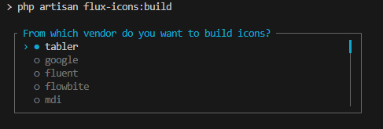

# Flux Icons

This is a laravel package to customize the icons for [Livewire Flux](https://github.com/livewire/flux). It builds the icons from various vendors into a `flux:icon` component.

[](https://packagist.org/packages/ympact/flux-icons)

## Installation

Generally you want to install this package only in your local development environment and build and publish the icons you need.

```cmd
composer require --dev ympact/flux-icons
```

Upgrading from 1.x? See [UPGRADE.md](UPGRADE.md).

## Icon Vendor Support

| Vendor       | Namespace   | Preview / Repo | Notes |
|--------------|-------------|----------------|-------|
| Bootstrap    | `bootstrap` | [Preview](https://icons.getbootstrap.com/#icons) | Stroke width of outline icons cannot be adjusted |
| VSC Codicons | `codicons`  | [Repo](https://github.com/microsoft/vscode-codicons/) | Only outline icons available, but stroke width cannot be adjusted. The icons are licensed CC BY 4.0, which requires attribution, and a built icon carries none on the page: credit Microsoft where your application credits the work it uses, such as an about page. |
| Flowbite     | `flowbite`  | [Preview](https://flowbite.com/icons/) |  |
| Flags        | `flags`     |  [Repo](https://github.com/lipis/flag-icons/) | There is only one variant (solid and outline show the same flag). The 4x3 version is built. For the square version, register a subclass whose `optionDefaults()` returns `['ratio' => '1x1']`: `--options=ratio=1x1` builds it once, and `flux-icons:update` rebuilds with the class's values. |
| Fluent UI    | `fluent`    | [Preview (unofficial)](https://fluenticons.co/) - [Repo](https://github.com/microsoft/fluentui-system-icons) | Stroke width of outline icons cannot be adjusted |
| Font Awesome Free | `font-awesome` | [Preview](https://fontawesome.com/search?ic=free) | Solid, Font Awesome's own default, in every Flux variant: `outline`, `solid`, `mini` and `micro` all draw the solid style. The regular style is `variant="regular"`, which Free draws for 273 of its 2001 icons and which shows solid for the rest. See [Font Awesome](#font-awesome) for the licence and Pro. |
| Font Awesome Free brands | `font-awesome-brands` | [Preview](https://fontawesome.com/search?ic=brands) | One style, shown in every variant. Brand logos are their owners' trademarks: use one only to refer to that brand. |
| Google Material Design Icons | `material` | [Preview](https://fonts.google.com/icons) | Stroke width of outline icons cannot be adjusted |
| Google Material Symbols (300) | `material-symbols` | [Preview](https://fonts.google.com/icons?icon.set=Material+Symbols) | Stroke width of outline icons cannot be adjusted |
| Healthicons  | `healthicons` | [Preview](https://healthicons.org) | Stroke width cannot be adjusted. |
| Lucide       | `lucide`    | [Preview](https://lucide.dev/icons/) | Only outline icons available |
| MDI          | `mdi`       | [Preview](https://pictogrammers.com/library/mdi/) | Stroke width of outline icons cannot be adjusted |
| Tabler       | `tabler`    | [Preview](https://tabler.io/icons) | |

### Font Awesome

Font Awesome Free's icons are licensed [CC BY 4.0](https://fontawesome.com/license/free), which requires attribution. Each icon file carries a short attribution comment, and Font Awesome asks that it is not removed, so a built icon keeps it: it is in the HTML of every page that shows the icon. The header of each built component also names the package and the licence, but as a Blade comment it does not reach the page.

Free draws 273 of its 2001 icons in the regular style, so every Flux variant draws the solid style and a menu keeps one style throughout. Flux's navigation components, such as `flux:navlist.item`, `flux:sidebar.item` and `flux:navbar.item`, ask for `outline`. The regular style is a variant of its own, which shows solid where Free has no regular drawing:

```html
<flux:icon.font-awesome.heart variant="regular" />
```

To draw the regular style as `outline` where it exists, extend the vendor (`php artisan flux-icons:make-vendor FontAwesome --extends=font-awesome`) and point `outline` at it:

```php
public function variants(): VariantSet
{
    return parent::variants()
        ->variant('outline', fn ($variant) => $variant
            ->source(Source::dir('regular'))
            ->fallback(Fallback::defaultVariant())
        );
}
```

Font Awesome Pro installs from Font Awesome's own registry. Configure it in your application's `.npmrc`, with the token from your environment rather than in the file ([Font Awesome's guide](https://docs.fontawesome.com/web/setup/packages)):

```ini
@fortawesome:registry=https://npm.fontawesome.com/
//npm.fontawesome.com/:_authToken=${FONTAWESOME_PACKAGE_TOKEN}
```

Then extend the vendor with `php artisan flux-icons:make-vendor FontAwesomePro --extends=font-awesome`, return `'@fortawesome/fontawesome-pro'` from its `package()` and a reference to your plan's licence from `license()`, such as `'LicenseRef-FontAwesome-Pro'` (SPDX's form for a licence it does not list), and register it. Pro's other styles, such as light, thin and duotone, need variants of their own (see [Adjusting a vendor](#adjusting-a-vendor)). This package is not tested against Pro.

Font Awesome Pro is a paid licence, and built Pro icons are copies of its files: keep them out of a public repository, and check [the Pro licence](https://fontawesome.com/license) for your case.

## Building icons

You will need to build the icons yourself once the package is installed. This can be done using the artisan command `flux-icons:build`. You can optionally pass the vendor name as the first argument; without one it builds from `defaults.vendor` in the config, or asks.

```cmd
php artisan flux-icons:build tabler --icons=confetti,confetti-off
```

The artisan script installs the vendor's icon package for you with `npm install` when `node_modules` does not hold it yet. npm runs in your application's directory, so your `package.json` and `.npmrc` apply, which is where a private registry is configured. When npm fails, the command stops and shows what npm said.
In case you did not provide any arguments, the script will walk you through all options



### Options

| Option          | Description                                                                                        |
|-----------------|----------------------------------------------------------------------------------------------------|
| `-I\|--icons=`  | The icons to build (single or comma separated list). Cannot be used in combination with `--all`. |
| `-M\|--merge`   | Merge the icons listed in the `--icons` option with the icons the config lists for the vendor and the ones [installed packages declare](#icons-a-package-needs). Cannot be used in combination with `--all`. |
| `-O\|--options=` | Options of the vendor for this build, as `name=value`, repeatable or comma separated: `--options=ratio=1x1`. They override the values the vendor class builds with, for this build only: `flux-icons:update` and later builds use the class's values again, so set a value that must last in a subclass's `optionDefaults()`. Without it, an interactive build asks for each option. |
| `-A\|--all`     | Build all icons from the vendor. **Note:** this might generate over thousands of files and cause `npm run dev` to crash due to memory issues. |
| `-v\|--verbose` | Show additional messages during build. |

### Usage

Since this package publishes all icons to `resources/views/flux/icon/{vendor}/` you can simply use the Blade convention of referencing the icons within your `flux:icon` component. So for example:

```html
<flux:icon.tabler.confetti />
or
<flux:icon name="tabler.confetti-off"/>
```

An icon takes Flux's variants, `outline`, `solid`, `mini` and `micro`, and any variant its vendor adds, such as Font Awesome's `regular` or Phosphor's `duotone` (`Ympact\FluxIcons\Vendors\Phosphor`, which the default config does not register). The header of each built component lists the variants it has. Without a `variant`, an icon draws its vendor's default variant, which is `outline` for every bundled vendor except Font Awesome, whose default is `solid`.

```html
<flux:icon.tabler.confetti variant="mini" />
<flux:icon.phosphor.heart variant="duotone" />
```

Asked for a variant it was not built with, an icon draws its default variant and marks the `<svg>` with `data-flux-icon-fallback="duotone"` (the variant asked for), so you can spot it in your browser's devtools instead of getting an error.

## Checking references

Flux resolves an icon to a Blade component and throws when it does not exist, so a template
that asks for an icon you never built is a 500 on whichever page renders it, and nothing
says so until that page is rendered. Whether a reference resolves is a static question, so
you can answer it without running the application:

```bash
php artisan flux-icons:check
```

It walks every registered view path (packages and modules included, not only
`resources/views`), plus your application's `app` and `config` directories, and reports the
references that have nothing behind them:

```
  Modules/Tools/resources/views/components/ambitie/transformaties.blade.php
    402  tabler.chart-histogram has not been built

   ERROR  1 icon reference does not resolve.
```

It exits non-zero, which makes it usable as a CI step next to your other static checks.

Only namespaced references are examined. A bare `icon="check"` is a Flux built-in and none
of this package's business; `icon="tabler.check"` is. References are found wherever they are
written: the tag form, the `name` attribute, any `icon`-like attribute, and inside a bound
expression. They all fail the same way.

In PHP files a reference is a string literal that holds nothing but the name, so an icon
name kept in an enum, a menu builder or a config array counts, and one in a comment does not.
A key handed to `config()`, `__()`, `trans()`, `view()` or `route()`, or to `Config::get()`
and its kind, is not read as one, although `config('flags.new_checkout')` looks like it.

In Blade templates, `{{-- --}}` comments and the PHP comments in `@php` and `<?php` blocks
are skipped. An HTML comment
still counts: Blade renders the components inside one. The icons the builder wrote are not
scanned, so they do not count as references to themselves.

A doubled namespace such as `tabler.tabler.check` is reported as malformed rather than as a
missing icon, since no build will ever produce it.

A `<flux:icon>` that asks for a variant its icon was not built with, written as a literal
such as `variant="duotone"`, is reported too. It draws the icon's default variant rather
than failing, which is easy to miss. A bound `:variant` is only known when the page renders.

### Options

| Option | Description |
| --- | --- |
| `vendor` | Only check icons of this vendor, given by its config key |
| `--path=` | Directories to scan, repeatable. Defaults to the registered view paths and the application's `app` and `config` directories. A directory that does not exist fails the check. |
| `--build` | Also print the `flux-icons:build` command that would add the missing icons |
| `--json` | Print the result as JSON instead, for CI and agents. It exits non-zero in the same cases. |

```bash
php artisan flux-icons:check tabler --build
```

With `--json`, each unresolved reference carries its `reason`: `not-built`, `malformed`,
`unknown-variant`, or `unknown-vendor` for an icon a package declares for a namespace no
configured vendor publishes to. A reference found in a file has its `file` and `line`; one a
package declares has `package` instead, and `null` for the other two. `vendor` is `null` for
`unknown-vendor`. `build` holds the command per vendor for the icons that are not built.
`left_out` holds the icons a package requires that the `packages` config leaves out and that
have not been built; they warn, and do not fail the check.
A problem that stops the check, such as an unknown vendor, prints `{"error": "..."}`.

```json
{
    "references": 12,
    "unresolved": [
        {
            "file": "resources/views/dashboard.blade.php",
            "line": 14,
            "package": null,
            "name": "tabler.chart-histogram",
            "vendor": "tabler",
            "variant": null,
            "reason": "not-built"
        }
    ],
    "build": [
        {
            "vendor": "tabler",
            "icons": ["chart-histogram"],
            "command": "php artisan flux-icons:build tabler --icons=chart-histogram --merge"
        }
    ],
    "left_out": [
        {
            "package": "acme/shop",
            "name": "tabler.map-pin"
        }
    ]
}
```

### Icons a package needs

A package that uses icons keeps their names in its own PHP, under `vendor/`, where
`flux-icons:check` does not look. It can declare them in its `composer.json` instead, by the
namespace its references use: under `icons` the ones its views require, and under `optional`
ones it can do without, such as icons a user may pick.

```json
{
    "extra": {
        "flux-icons": {
            "icons": {
                "tabler": ["calendar-month", "map-pin"]
            },
            "optional": {
                "tabler": ["chart-bar"]
            }
        }
    }
}
```

The application does not repeat them in its own config. Both commands read the declarations
of every installed package from `vendor/composer/installed.json`, as Laravel's package
discovery does, and take the required and the optional icons alike:

- `flux-icons:build tabler`, without `--icons`, builds the declared icons along with the ones
  the `icons` config lists for the vendor. When it lists none, the build takes every icon, the
  declared ones included. `--merge` adds them to the icons asked for.
- `flux-icons:check` reports a declared icon that has not been built under the package that
  declared it. It also reports an icon declared for a namespace that no configured vendor
  publishes to, unless you check a single vendor.

A name that is not an icon name, such as one with a space or a `$`, is left out.

To leave declared icons out, name the package in the `packages` config:

```php
'packages' => [
    // leave out the optional icons of acme/shop
    'acme/shop' => ['optional' => false],
    // also leave out the ones its views require, because you override those views
    'acme/blog' => ['required' => false],
    // leave out single icons
    'acme/crm' => ['except' => ['tabler.map-pin']],
    // leave out everything a package declares
    'acme/legacy' => false,
],
```

Leaving out a required icon is allowed, since you may have replaced the views that use it,
but `flux-icons:check` warns about each one that has not been built: the package's own views
fail where they use it. `--json` lists them under `left_out`.

## Configuration

Publish the config file to choose the icons that are built by default or to register vendors:

```cmd
php artisan vendor:publish --tag=flux-icons-config
```

| Option            | Value | Description |
|-------------------|-------|-------------|
| `defaults.vendor` | `null` or a vendor key | The vendor `flux-icons:build` builds from when none is passed to it. |
| `icons`           | `null` or `['vendor-key' => ['icon-name', ...]]` | The icons `flux-icons:build` builds when no icons are passed to it, together with the ones [installed packages declare](#icons-a-package-needs). |
| `packages`        | `['vendor/package' => false or ['optional' => false, 'required' => false, 'except' => ['tabler.map-pin']]]` | The icons [installed packages declare](#icons-a-package-needs) to leave out, by package. |
| `request_npm_dev` | `bool` | For a build of more than 100 icons, ask whether `npm run dev` is running, and if so pause a third of a second between icons and remind you to start it again afterwards. Without a terminal the answer is no. |
| `vendors`         | `['vendor-key' => VendorClass::class]` | The vendors icons can be built from. The key is what you pass to the commands. The icons are published under the key as a slug (`tabler_icons` to `tabler-icons`), unless the class names another namespace (Material Icons publishes to `material`). |

A published config from version 1 describes vendors as arrays. The build, update and check commands, and `make-vendor --extends`, stop with a message naming the vendor. Keep a copy of `config/flux-icons.php`, replace it with `php artisan vendor:publish --tag=flux-icons-config --force`, then copy your changes over from the copy. [UPGRADE.md](UPGRADE.md) maps each version 1 setting to version 2.

### Adjusting a vendor

Each vendor is a class. To change how its icons are built, extend it:

```cmd
php artisan flux-icons:make-vendor Tabler --extends=tabler
```

This writes `app/FluxIcons/Vendors/Tabler.php`, a subclass of the registered vendor in your application's namespace, and prints the line that registers it in your published config: `'tabler' => \App\FluxIcons\Vendors\Tabler::class`. It leaves an existing class alone unless you pass `--force`. Override any of these methods:

| Method | Adjusts |
|--------|---------|
| `package()` | The npm package the icons are installed from. |
| `license()` | The licence of the icons, as an SPDX identifier, named in the header of each built icon. |
| `variants()` | The variants: their source files, template, stroke, fallback and attributes. |
| `transform()` | The paths of an icon before it is written. |
| `attributes()` | The attributes on an icon's `<svg>` element. |
| `strokeWidth()` | The stroke width of a single icon. |
| `iconName()` | The name an icon is published under. |
| `optionDefaults()` | The option values the vendor builds with, such as `['ratio' => '1x1']` for the square flags. `options()` lists the values each option takes. |
| `namespace()` | The directory and Flux namespace the icons are published under, `<flux:icon.{namespace}.home />`. Defaults to the registered key as a slug; Material Icons returns `material`. A v1 `namespace` setting moves here. |

For example, a heavier stroke for Tabler's outline icons:

```php
namespace App\FluxIcons\Vendors;

use Ympact\FluxIcons\Variants\Stroke;
use Ympact\FluxIcons\Variants\VariantSet;
use Ympact\FluxIcons\Vendors\Tabler as BaseVendor;

class Tabler extends BaseVendor
{
    public function variants(): VariantSet
    {
        return parent::variants()
            ->variant('outline', fn ($variant) => $variant->stroke(new Stroke(2)));
    }
}
```

### Adding a vendor

A vendor of your own extends `Ympact\FluxIcons\Contracts\Vendor`, names its npm package and defines its variants, and is registered under a key in the `vendors` config. `php artisan flux-icons:make-vendor HouseStyle` generates one to fill in. [The architecture notes](docs/v2-architecture.md) describe variants, sources, fallbacks and how an icon is rendered. In case you add a vendor, please share it or make a PR so others can use it too!

## Additional icons

This package also provide some custom icons that can be published:

They can be published using

```cmd
php artisan vendor:publish --tag=flux-icons-icons
```

- An empty icon, can be useful for simple logic in your blade or components:
  
  ```html
  <flux:icon name="{{ $icon ?? 'flux-icons.empty' }}" />
  ```

- A placeholder avatar icon, using an icon or initials

  ```html
  <flux:icon.flux-icons.avatar-placeholder name="Maurits Korse" color="green" />
  <flux:icon.flux-icons.avatar-placeholder icon color="green" />
  ```

  This icon has additional properties:
  - **icon** `(void|string)`: uses the Heroicon user icon as image.
  - **name** `(string)`: instead of an icon two initials of a name will be shown. You can pass the full name (Maurits Korse) or just the initials (MK)
  - **color** `(string)`: colorizing the icon using the same as Flux badges

## Events

After a build has written at least one icon, `Ympact\FluxIcons\Events\IconsBuilt` is dispatched. Listen for it to refresh anything that catalogues your icons, such as a cache.

| Property | Description |
| --- | --- |
| `vendor` | The vendor's key in the config, e.g. `tabler`. |
| `namespace` | The directory the icons were written to, and their prefix: `<flux:icon.{namespace}.{name} />`. |
| `directory` | The absolute path of that directory. |
| `icons` | The names of the icons written. |

A build that writes nothing, for example because no requested icon exists, dispatches nothing.

## Roadmap

- Add/Improve command for updating/rebuilding icons
- Adding more vendors
- Helper script to create configurations for new vendors
- Improving testing
- Documentation
